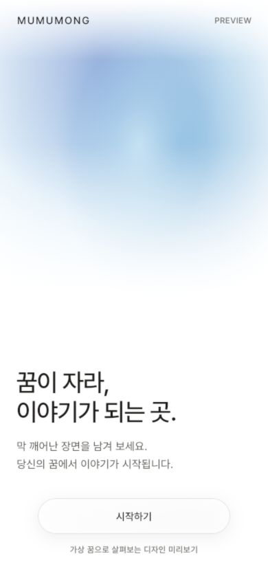

# P2 연속 화면 리뷰

> 역사적 P2 기록. 현재 실행 소스·테스트·캡처 도구는 P3 출력 디렉터리를 사용한다. 아래 명령으로 P2 사진을 재생성하려면 당시 P2 소스가 필요하며 현재 소스로 이 디렉터리를 덮어쓰지 않는다. 최신 화면은 `../2026-10-18-p3/README.md`를 따른다.

2026-10-15. P2 범위: 소개 → 꿈 기록 → 처리 → 새 장면, 같은 가상 꿈으로 실행. 공개 재배포는 하지 않았다. 이 이미지와 로컬 미리보기는 Memory/mock fixture이며 실제 사용자의 꿈·LLM 품질 평가가 아니다.

## P1/P2 비교

| 화면 | P1 기준선 | P2 밝은 후보 | P2 야간 후보 |
|---|---|---|---|
| 소개 | [P1](../2026-10-15/01-entry.png) | [P2](day-390-844-normal-entry.png) | [야간](night-390-844-normal-entry.png) |
| 꿈 기록 | [P1](../2026-10-15/08-capture.png) | [P2](day-390-844-normal-capture.png) | [야간](night-390-844-normal-capture.png) |
| 생성 | [P1](../2026-10-15/10-processing.png) | [P2](day-390-844-normal-processing.png) | [야간](night-390-844-normal-processing.png) |
| 새 장면 | [P1](../2026-10-15/11-reveal.png) | [P2](day-390-844-normal-reveal.png) | [야간](night-390-844-normal-reveal.png) |
| 원고 홈(큰 표지 유지) | [P1](../2026-10-15/04-home.png) | [P2](04-home.png) | 전역 테마는 P3 |

흰색에서 빛이 드러나고 상부 블루·라일락 초점이 아래 흰색으로 사라진다. 입력은 정적이고 UI 산세리프다. 처리 화면은 native 64px Thinking Orb와 짧은 상태만 보인다. 결과는 제목/첫 문단 미리보기와 ‘새 장면 읽기’가 주 행동이며 연결·배치 설정은 별도 시트다.

## 동작 설명

1. 소개의 빛은 14초 주기로 움직인다. CustomPainter만 repaint하고 화면/부모의 per-frame rebuild는 하지 않는다. 상단·하단은 바탕색과 연결된다.
2. 타이핑/STT에는 Orb·beam·픽셀·레벨 연출이 없다. 키보드가 열리면 약한 배경 빛도 숨겨 입력과 저장 면만 남긴다.
3. `submitDream`이 끝난 뒤 저장 확인과 32px 픽셀 스탬프가 650ms 한 번 모인다. 저장 실패에서는 이 단계에 진입하지 않는다.
4. 기존 보강/건너뛰기 후 실제 job stage로 Orb working→connecting→composing→solving을 선택한다. 고정 완료 타이머·가짜 퍼센트는 없다.
5. 완료 job과 동기화된 로컬 scene/passages를 받은 뒤 결과로 360ms 전환한다. 실제 title/첫 paragraph와 delta만 보이고 주 행동은 해당 장면 Reader를 연다.
6. 동작 줄이기에서는 빛/Orb/저장 스탬프가 정적 상태이고 긴 전환을 생략한다.

보강의 3개 고정 질문은 아직 이전 계약이다. 저장 후 ‘장면 만들기’/선택적 보강·나중에 만들기로 분리하는 작업은 P3이다. 생성에서 떠나기/복귀는 P4다. 야간 후보는 같은 네 화면 ThemeData 검증이며 전역 토글/저장 설정이 아니다.

## 실제 실행 검증

- Flutter 테스트 **183개** 통과. 네 화면 day/night × 4크기 및 작은 화면 1.6배 글자: 40 golden PNG 생성·재비교. 낮/밤 375×667에서 keyboard inset 290px + 글자 1.5배여도 저장 행동 접근 가능.
- 14초 주기가 끝난 뒤 17초→20초의 raster pixel 비교에서 RGB 합계 차이 >18인 표본이 8% 이상. 동작 줄이기에서 clock 없음/진행 animation 없음 검증. 물리기기 프레임 측정이 아니다.
- 저장된 가상 rawText와 성공 스탬프, 결과 주 행동 1개, 숨겨진 연결 선택과 조정 시트의 실제 MemoryRepository 결정 저장(day/night) 확인.
- iPhone 17 Pro / iOS 26.5 시뮬레이터 **5개** 통합 시나리오 통과: 성공/재시도/fallback/실패 및 SQLite 재열기+큰 글자 읽기 앵커. 성공 결과는 새 장면 읽기를 눌러 동일 본문 Reader까지 확인.
- 로컬 in-app browser 390×844: 소개→홈→가상 꿈 입력→저장→Orb→리빌→연결 결정 시트→새 장면 본문을 직접 조작·화면 확인. error/warn 로그 없음. localhost의 Memory/mock 경로이며 서버 요청/계정/실제 AI는 없음.
- format 98파일 변경 없음, 직접 Dart 분석 No issues found, 로그/평가 privacy guards 통과, frozen 4파일 edfc13c diff 없음. root `flutter analyze`는 기존 한국어 경로 LSP JSON parser crash(exit 255)로 실패했다.
- 일반 web release와 별도 `build/p2-review` visual-preview release, iOS simulator 무서명 build 통과.
- 기존 14개 상태 캡처도 이 디렉터리에서 생성·재비교했다. P0/P1 원본은 그대로 보존했다.

## 재현

```sh
flutter test --no-pub test/ui/dream_flow_visual_test.dart
flutter test --no-pub tool/ux_baseline_capture_test.dart
flutter build web --release --no-pub --target tool/visual_preview.dart --output build/p2-review
python3 -m http.server 4202 --bind 127.0.0.1 --directory build/p2-review
```

처음 새 snapshot을 만들 때만 test에 `--update-goldens`를 추가한다. 이미지에는 폰트가 로드됐고 devicePixelRatio=1/동작 줄이기가 적용돼 있다. tool 캡처는 kIsWeb=false인 widget renderer, 브라우저는 웹 텍스트 전용 경로다.

## 미검증

물리 iPhone/PWA의 상태바·키보드·터치 지연·frame timing·STT, hosted 전체 계정/동의/실제 생성 흐름, 문학적 충실도, private eval/holdout, 전역 night theme/system-bar 일치. 라이브 서버나 원고 DB는 이 시각 작업에서 변경하지 않았다. 로컬 review 링크는 시각 검토용이며 공개 AI 서비스로 다시 게시하지 않는다.

## 직접 확인한 로컬 웹 진입

아래는 in-app browser 390×844 캡처다. Apple/실제 AI 없는 가상 디자인 미리보기로 표시된다. 위 matrix PNG들은 별도의 widget renderer 캡처다.


