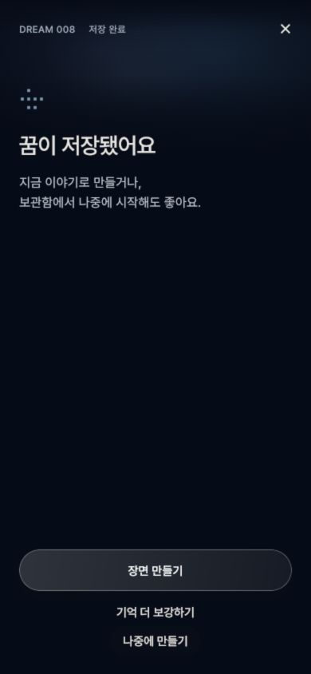

# P3 공통 UX·디자인 적용 리뷰

> P4부터 처리 golden과 `tool/ux_baseline_capture_test.dart`의 기본 출력은 `2026-10-18-p4`를 사용한다. 이 디렉터리의 P3 PNG는 보존한다. 아래 재현 명령을 최신 소스에서 실행하는 것이 당시 모든 화면을 다시 만드는 것은 아니다.

2026-10-18 KST. 로컬 구현/검증이며 운영 배포가 아니다. widget 이미지와 로컬 미리보기는 Memory/mock의 가상 데이터이고, 입력한 꿈에 대한 실제 AI 결과·문학적 충실도 증거가 아니다. 전체 시스템 규격: [Design System v0.7](../../MUMUMONG_DESIGN_SYSTEM_v0.7.md).

## 전후 화면

| 화면 | P2 | P3 |
|---|---|---|
| 첫 원고 | [모든 선택지 먼저 표시](../2026-10-15-p2/03-volume-setup.png) | [기본값으로 시작](day-390-844-normal-setup.png), 상세 설정은 선택 |
| 저장 뒤 | [보강 질문이 바로 나옴](../2026-10-15-p2/09-recall.png) | [장면 만들기 한 주 행동](day-390-844-normal-saved.png) |
| 설정 | [이전 설정](../2026-10-15-p2/06-settings.png) | [공통 위계/표시 설정](day-390-844-normal-settings.png) |
| 야간 표시 | 네 화면 ThemeData 후보 | [앱 설정으로 저장](night-390-844-normal-appearance.png) |
| 보관함 | [이전 보관함](../2026-10-15-p2/05-archive.png) | [정리된 목록](day-390-844-normal-archive.png), 저장한 꿈 재개 |
| Reader | [이전 읽기](../2026-10-15-p2/07-reader.png) | [문단 메뉴](day-390-844-normal-reader.png), [넓은 화면 폭 제한](day-1200-800-normal-reader.png) |

matrix: day/night × 375×667, 390×844, 430×932, 1200×800, 375×667 1.6배 글자. 소개/기록/저장/처리/새 장면 50장 + 첫 설정/설정 허브/표시 설정/보관함/Reader 50장. 기존 단계 캡처 도구의 14장도 별도로 생성·재비교한다. P0/P1/P2 기준 이미지는 보존했다.

## 바뀐 실제 동작

- 저장 성공 후 ‘장면 만들기’가 주 행동, 보강/나중에 만들기는 보조 행동이다. 선택적 보강은 답변만 저장하고 돌아온다. 나중에 만들기를 눌러도 AI enqueue는 하지 않는다. 저장한 queued 꿈은 보관함→생성 시작→같은 꿈 ID를 이어 쓴다.
- `saveRecallAnswers`는 queued 상태의 저자 입력만 바꾼다. Drift transaction에 원래 safe-upsert `create_dream` 전달을 추가하되 **process_dream은 추가하지 않는다**. 이미 처리한 create 작업에 묻히지 않도록 수정 전달은 새 interaction ID를 사용한다. 실제 생성 의도(`answerRecall`) 때만 process 작업이 큐에 들어간다.
- 첫 원고는 balanced/plain/first-person-past 기본값으로 바로 생성한다. 선택적 상세 설정 값·요약·실패 후 재시도 값을 유지한다. hosted 생성 API와 동의 흐름은 기존 경로를 그대로 쓴다.
- 고지 제공사 URL 열기/실패 시 복사와 피드백을 제공한다. 계정 시작 전에 읽을 수 있는 가상 예시는 명시적 sample이며 API 호출/계정 생성/실제 동의는 없다.
- 홈의 주 행동은 첫 문단 열람 마커가 없는 실제 로컬 장면을 읽는 행동으로 전환한다. Reader 개방 후 기존 마커가 저장되고 해당 결과는 주 행동 대상에서 빠진다. 완독 측정은 아니다. 저장됨/생성 대기·처리/실패 항목은 보관함에서 확인할 수 있다.
- Reader 문단마다 출처/수정/복원 메뉴가 있다. 편집·원문 수정의 저장 중 중복 실행을 막고 실패 시 입력을 보존한다. 생성 원고 직접 DB 교정은 없으며 기존 U 편집/복원 계약을 유지한다.
- 테마/원고 글자 크기/출처 표시를 기기에 저장한다. 내용·생성 설정·서버 계정 설정은 아니다. 기본은 밝게/1.0/출처 표시 끄기다.

## 실행 검증과 경계

Flutter 전체 **206개 통과**, 시뮬레이터 **7개 통과**. 빌드·환경 오류와 미검증 경계는 [최신 실행 상태](../../UX_REBUILD_STATUS.md)를 따른다. 이번에 직접 실행한 검증:

- 100개 matrix golden 생성·재비교, 작은 화면 큰 글자에서 목록/상세 선택/문단 메뉴 접근. 기존 keyboard day/night 375×667, inset 290px, 글자 1.5배 검사 유지.
- Memory/Drift 공통 계약: 생성 없이 보강 저장, queued job 유지, 처리 시작 뒤 보강 변경 거절.
- 임시 SQLite 파일+Outbox: 최초 저장과 보강을 전송해도 `create_dream`만 전달, 파일 재열기 후 queued/보강 답변 유지, 명시적 시작 후에만 process_dream 전달.
- UI: 선택적 보강→나중에 만들기→보관함 재개→같은 ID enqueue, 미열람 홈 행동 전환, 기본/사용자 첫 원고 설정과 실패 재시도, 실제 링크 URL 전달과 열기 실패→복사 피드백, 문단 메뉴 편집 실패/재시도/U 복원.
- iPhone 17 Pro / iOS 26.5 시뮬레이터 **7개** 통합 시나리오 통과. 새 SQLite 저장/보강 재열기→명시적 mock 생성, 네이티브 preference 채널 write→reload→새 컨트롤러 복원, 기존 capture 4경로와 Reader bookmark 재열기.
- 로컬 브라우저: 390×844에서 theme/원고 1.4배 선택→reload 복원, 기록→저장만 하고 나감→보관함→동일 꿈 재개→명시적 생성→Orb→새 장면→Reader/문단 메뉴를 조작했다. error/warn 로그 없음. 사진은 widget 이미지와 구분한다. HTTP 서버는 정적 파일만 제공하고 API/계정/LLM은 사용하지 않는다.
- root `flutter analyze`는 기존 한국어 경로 LSP JSON crash(exit 255)로 실패. 직접 Dart 분석은 별도로 실행했다. 서버/엔진/Q prompt/모델/SQL 스키마는 변경하지 않았다. Drift 스키마는 v2 그대로다.

실제 hosted 계정/동의/AI·RLS 검수, 물리 iPhone/PWA·시스템 크롬·STT·터치 지연/frame timing, 사용자 5명 사용성 실험은 **미검증**이다. 공개 재배포 없음. private eval/holdout에는 접근하지 않았다. 기존 offline cold-start 인증 게이트도 우회하지 않았다.

## 직접 확인한 로컬 웹



[새로고침 후 야간 진입](browser-night-entry.jpg) · [복원된 야간/원고 1.4배 설정](browser-restored-appearance.jpg) · [읽기 메뉴](browser-reader-menu.jpg)

## 재현

```sh
flutter test --no-pub test/ui/dream_flow_visual_test.dart test/ui/p3_system_visual_test.dart
flutter test --no-pub test/ui/p3_flow_test.dart test/core/ui_preferences_test.dart test/data/local/save_without_generation_test.dart
flutter test --no-pub tool/ux_baseline_capture_test.dart
flutter build web --release --no-pub --target tool/visual_preview.dart --output build/p3-review
python3 -m http.server 4203 --bind 127.0.0.1 --directory build/p3-review
```

`--update-goldens`는 새 기준을 의도적으로 생성할 때만 추가한다. 현재 테스트 경로는 P3 산출물이며 P2의 시각 증거를 다시 만들려면 당시 소스가 필요하다. 공개 mock 재게시에는 사용하지 않는다.
