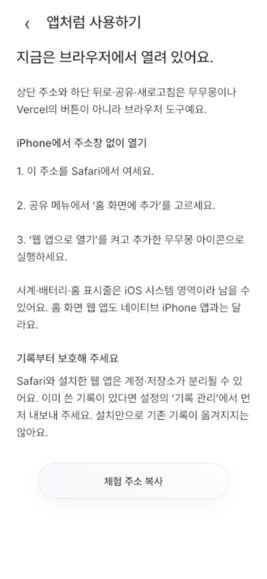
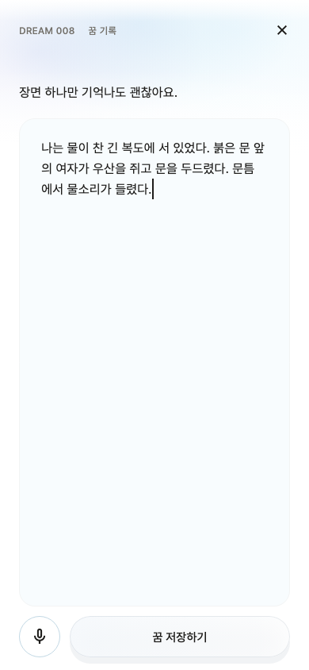

# 모바일 지적 후 수정 / native 준비

## 범위와 원인

공개 주소는 Flutter **웹 체험판**이었다. PDR§12는 음성 기본, M1 Report§5.5/WO16은 iOS 온디바이스 전용·서버 폴백 금지다. 웹에서 이 recognizer를 못 쓴다는 이유로 녹음 버튼을 숨겼고 웹/앱 차이를 충분히 설명하지 않았다. 이를 네이티브 배포 완료라고 말하지 않는다. 사용자 선택은 ‘기획서대로 iPhone 앱 준비’다.

사용자 사진의 상단 Vercel 도메인은 브라우저 주소이며 하단 뒤로/공유/새로고침/Safari 아이콘도 브라우저 UI다. 웹페이지가 이를 강제로 없앨 수 없다. 네이티브 앱에는 브라우저 영역이 없고 iOS 시스템 시간/배터리/홈 표시줄은 남을 수 있다. 웹은 Safari→공유→홈 화면에 추가→웹 앱으로 열기를 안내한다. PWA가 native 녹음/기록 이전을 제공한다고 안내하지 않는다.

## 수정

- 배경14초 모션/글래스 외형/선택 반응 유지. 고주사율 source clock의 repaint 알림을30Hz 이하로 제한하고 앱 background에서 정지한다. 이는 CPU/GPU 실측이나 FPS 보장이 아니다.
- Flutter 엔진 CanvasKit `loadAssetFonts`가 manifest 폰트를 모두 다운로드함을 설치된 SDK 소스로 확인했다. PDF에서만 쓰는 MaruBuri-Bold3,351,940bytes를 font manifest에서 빼고 일반 asset으로 보관했다. 초기 UI 폰트의 원본 합계9,779,348→6,427,408bytes, 아이콘/기본 fallback 제외 기준이다. 전체 앱 다운로드나 압축 전송량/실기기 시작 시간을 뜻하지 않는다. PDF rootBundle 로드는 유지한다.
- native 녹음 미사용RMS 계산/Flutter 채널 전송 제거. 부분 전사/5분 종료/인식 불가 fallback/오디오 파일 미저장 계약 유지. 실제 음성 정확도는 검증하지 않았다.
- native 버튼을 명확한 마이크/정지 아이콘으로 바꿨다. 첫 simulator 검증이 음성 불가 SnackBar의 키보드 위 저장 CTA 가림을 발견했다. 정적 prompt 안내로 옮긴 재실행은 통과했다.
- 웹 녹음은 위장 구현하지 않았다. ‘iPhone 앱 전용’ 문구와 마이크 안내를 제공하고 브라우저 마이크/서버 STT를 켜지 않는다. 키보드 받아쓰기는 별도 OS 설정임을 설명한다.
- 소개/설정에 설치 안내, 실제 standalone 감지, 기존 Safari/PWA 계정 저장소 분리 경고를 추가했다. manifest의 stable root id/scope/start_url 및 legacy Apple web-app meta를 명시했다. 사용자 저장소/세션/캐시는 지우지 않았다.
- 버튼 blur 제거 실험은5% 내외 픽셀 변화 등 다수 시각 회귀를 일으켜 채택하지 않았다. 원래 material로 되돌린 뒤 기존 전체 비교가 통과했다. 새 capture10개는 이 디렉터리의 별도 baseline으로 보관한다.

## 실행한 검증

- 전체 Flutter299개 통과. 새7개는 bundle PDF font,120Hz120 tick→28–31회 repaint 알림, lifecycle 정지/재개, 유리 재질 유지,375×667/1.6배 설치 안내2상태, 웹 음성 안내의 정직성을 확인한다.
- native simulator 신규1개 통과: 마이크 아이콘→인식 불가 주입→텍스트 입력/초안 저장→키보드 위 저장 CTA 접근. 실제 녹음 정확도 검사 아니다.
- ARM64 remote/auth unsigned archive 및 simulator release build 통과. native archive1.0.0(2),buildID `ios-20261023T074903Z`. Bold는 font manifest에 없고 asset에는3,351,940bytes로 남음을 직접 검사했다.
- Dart format/직접 분석/diff/log/privacy guards 통과. `flutter analyze`는 기존 한국어 경로 LSP JSON crash exit255로 실패했다. frozen4파일 edfc13c와 동일, engine/SQL/model 변경 없음.
- 브라우저 성능 Resource Timing API는 현재 자동화 도구에서 노출되지 않아 측정하지 못했다. 물리 iPhone FPS/터치/전송시간은 **미검증**이다.

## 웹 배포 식별

빌드 `20261023T075122Z`, source input SHA-256 `0161995ac97ccb8efd955448c3644b997b544c654a88bc35826975f870cee43a`, deployment `dpl_DwdEhmErQhbcKAPrmPwjPxD4qSmj`. HEAD6c4e296의 기존 dirty tree에서 빌드했으며 commit/push 없음. 보호된 stage18파일 로컬 해시 일치→동일 deployment promote→[공개 주소](https://mumumong-live-trial.vercel.app/) 비로그인18파일200/해시 일치 및 Bold 초기 다운로드 제외를 확인했다.390×844 공개 소개→설치 안내에서 실제 browser/standalone 감지와 저장소 경고가 표시됐고 console error/warn0이었다. 동의·계정 생성은 제출하지 않았다. 이전 배포의 서버 SQL0020/품질 실패 경계는 그대로다.

## TestFlight 중단선

서명 인증서0개,Runner DEVELOPMENT_TEAM 미설정. signed 모드는 이 상태에서 실패하도록 preflight했다. **설치 가능한 IPA/서명/업로드/TestFlight 설치는 하지 못했다.** 아카이브194.7MB는 dSYM154MiB를 포함하며 앱 본체 약32MiB와 다르다. 실제 TestFlight 다운로드 크기를 측정한 것이 아니다. 기본 launch image 경고와 출시 metadata/Apple 실로그인·실기기 STT10회 검수도 남는다. [준비 파일·다음 단계](../../IOS_TESTFLIGHT_PREPARATION.md).

