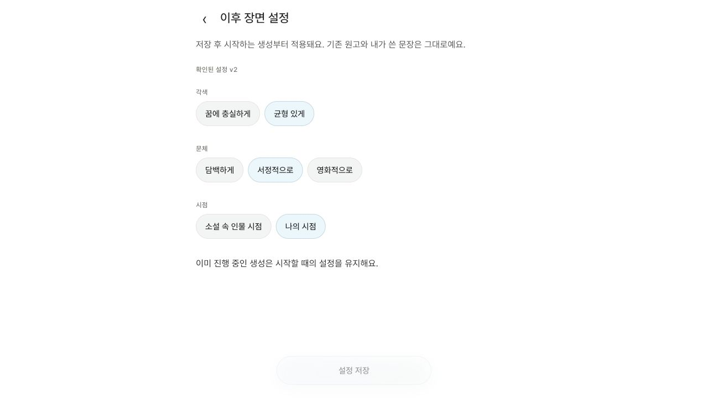
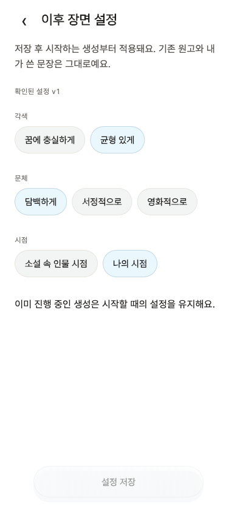

# P4-2 — 이후 장면 설정

2026-10-23 KST. 페이즈 실행지시서 §7의 P4-2만 구현했다. 공개 사이트/hosted DB/함수는 배포하지 않았다. 기존 원고를 DB에 직접 교정하지 않았다.

## 동작 계약

- 설정 → **이후 장면 설정**. 기존 `faithful/balanced`, `plain/lyrical/cinematic`, `first_person_past/third_person_past` 범위만 노출한다. 새 저장이 기존 원고/U·출처·읽음·성장·초안을 변경하거나 생성을 시작하지 않는다. 작업 중 설정을 바꿔도 이미 시작한 생성은 그대로다.
- 원격: 확인된 Volume vN과 이 기기의 대기 선택을 분리한다. 변경/Outbox는 한 SQLite transaction으로 저장한다. 서버 확인 전에는 새 생성만 차단하고 꿈 저장/읽기는 유지한다. 선택을 취소하고 뒤로 가는 것은 저장을 만들지 않는다. 대기 변경은 응답 유실 가능성이 있으므로 무조건 취소/덮어쓰지 않는다.
- `update_generation_settings` Outbox는 `volume:<id>` lane과 UUID mutation ID를 사용한다. HTTP 실패/응답 유실/재시도는 동일 요청이다. 6회 실패 후에도 대기 선택을 보존하고 화면의 재시도로 같은 ID를 다시 전송한다. 일반 backoff/재접속 drain은 기존 worker를 쓴다.
- RPC는 owner + expected version CAS + mutation ID로 중복 적용을 방지한다. 충돌이면 서버 최신 확인값을 받되 로컬 선택을 유지한다. **서버 설정 사용**은 대기를 정리하고, **이 기기의 선택 적용**은 최신 확인 버전을 기준으로 새 mutation을 만든다. 오래된 ACK/bundle이 최신 버전이나 더 새 대기를 지우지 않는다. 계정 변경/전체 삭제 때 로컬 대기도 정리한다.
- `answerRecall` transaction이 확인된 설정 버전을 작업에 고정한다. 대기/충돌은 새 생성을 시작하지 못하지만 이미 고정된 같은 꿈의 재시도는 원래 버전을 유지한다. 설정 편집과 생성 의도가 겹치면 transaction 순서로 결정한다.
- 서버는 소유 권의 버전 이력에서 스냅샷을 재구성한다. 클라이언트가 보낸 실제 설정값은 신뢰하지 않는다. 이후 단계/재시도도 동일 버전이며 payload에서 스냅샷을 제거/변경할 수 없다. 버전 없는 구 클라이언트는 서버 삽입 시점의 최신 설정을 사용한다. 기존 동의/owner/최초 extract 제한과 trial 한도는 유지한다.
- plan/write 진입점은 고정된 세 설정만 현재 권 컨텍스트에 덮어 전달한다. 장르 등 다른 필드는 보존한다. 동결 `write.v10`, `plan.v6`, `opening_expansion`, `opening_polish`는 `edfc13c` 대비 diff 없음. 품질/모델/Q 후보는 변경하지 않았다. 평가 baseline의 스냅샷 없는 입력 계약도 그대로다.
- Memory/로컬 모드는 즉시 버전을 올린다. 미리보기 원고는 여전히 입력과 무관한 고정 mock이며 실제 문체/충실도 검증으로 취급하지 않는다.

## 저장소·반영 순서

Drift **v3→v4**: 권 `settings_version` 기본1, 권별 `generation_settings_changes` 추가. 과거 **실제로 시작한** 작업(attempt>0)만 v1을 backfill한다. 아직 생성하지 않은 저장 기록의 queued placeholder는 버전을 정하지 않으므로 대기 설정을 우회하지 않는다. 기존 v1/v2→v4 경로도 보존 검사했다. 로컬 DB를 이전 스키마 앱으로 다운그레이드하거나 삭제해 되돌리지 않는다.

SQL **0017_generation_settings.sql**: 버전 필드/이력, 최초 v1 seed, 직접 설정 변경 방지, `user_update_generation_settings`, RLS, 기존 작업 backfill 및 immutable snapshot trigger. migration이 기존 꿈/원고/U의 모든 행을 바꾸지 않는지 해시로 비교했다. v1 이력을 삭제하는 destructive rollback 대신 forward fix를 사용한다.

공개 반영 시 **호환되는 engine-plan/write wrapper → SQL0017 및 권한 검증 → 새 클라이언트** 순으로 진행한다. 둘 다 준비되기 전에는 설정 편집 클라이언트를 공개하지 않는다. 구 서버에 새 클라이언트만 배포하면 설정 RPC/작업 삽입이 실패한다. 이번에는 어떤 운영 migration/함수/프론트도 반영하지 않았다.

## 실제 실행한 검증

| 검사 | 결과와 경계 |
|---|---|
| `flutter test` | **286개 통과**, 이번 단위 신규26개. 저장 실패/선택 유지/취소/대기/충돌, Memory/Drift, Outbox 실패→재시도, lost ACK/late ACK/stale bundle/계정 변경, 생성 버전·U 보존 포함 |
| SQLite migration/reopen | v1/v2/v3→v4와 대기 변경/Outbox 재열기. 원고/U/초안/영수증/북마크 보존 |
| `bash tool/test_generation_settings.sh` | **202개 항목 통과**: nonempty 0016→0017 upgrade5 + 기존/신규 SQL197. 소유권/동의/RLS/CAS/중복/역사 버전/스냅샷/원고 보존. RPC suite의 cron1 항목은 제외 |
| `npx --yes deno test --config supabase/functions/deno.json --allow-env supabase/functions` | **147개 통과**. API/LLM 호출은 테스트 fake이며 새 pinning 검사2개 포함 |
| Deno check | engine-plan/index.ts·engine-write/index.ts 통과 |
| `dart format --output=none --set-exit-if-changed lib test` | 통과 |
| `dart analyze lib test integration_test tool/visual_preview.dart` | No issues found |
| `flutter analyze` | **실패**, 기존 한국어 경로 LSP JSON `Unexpected end of input`, exit255. 직접 분석을 이 명령 통과로 바꾸어 보고하지 않음 |
| `flutter test integration_test/generation_settings_test.dart -d 8E9105D0-8358-49B1-8E15-B9ABF0A6DFB1 --no-pub` | **시뮬레이터1개 통과**, 설정 UI→저장→SQLite 종료/재열기→다음 생성 v2, 기존 원고/U 보존. Xcode19.9초 + 테스트2초. 실제 서버 호출 아님 |
| 시각 회귀 | 새 설정10개 + 개정된 overview/shell20개 day/night×4크기/큰글자; 전체 suite에서 이전 화면도 비교. 별도14화면 도구 생성·재비교 통과 |
| 순차 빌드 | unsigned iOS simulator11.8초, 일반 web release26.7초, local preview release26.8초 통과. 두 web 산출물 각각 폰트/아이콘/SQLite 등 필수14개 asset guard 통과 |
| 브라우저 | 별도 로컬 탭에서 가상 온보딩→첫 설정→설정→문체 변경→저장 **v2** 확인. warning/error 로그0. 기존 사용 중 탭을 강제 새로고침하지 않음 |
| guards | eval privacy/log safety, diff 공백, frozen4파일 비교 통과. 비공개 eval 데이터는 읽거나 출력하지 않음 |

SQL 러너는 기존 `supabase_db_mumumong` 컨테이너 안에 별도 disposable DB만 만든다. 최소 auth.uid/role/jwt 및 repo seed를 사용하므로 hosted Auth/PostgREST 검증이 아니다. pg_cron은 postgres DB 전용이어서 설치/스케줄을 건드리지 않았다. 러너는 테스트 DB를 종료 시 삭제한다. 이번에 별도 생성했던 수동 SQL 검증 DB도 삭제했고 사용자 DB를 reset/변경하지 않았다. 로컬 검증을 위해 정지되어 있던 Colima를 시작했다.

최초 widget fixture는 fake-async Stream.first 대기로 정지해 중단했다. fixture 준비를 runAsync로 바꾸고 선택 후 pump/지연 생성된 항목의 scroll 대기를 보완해 재실행했다. 최초 native 실행은 Swift package product 로딩 오류였고 순차 simulator build 후 `--no-pub` 재실행이 통과했다. SQL 검증에서 기존 RLS의 `{}` payload 제한이 canonical snapshot도 차단함을 찾아, 허용 키2개만 제외하고 나머지 payload는 계속 금지하도록 수정했다. 별도 upgrade fixture가 기존 suite의 job/RLS 검사에 간섭했던 것은 fixture를 제거해 해결했으며 제품 제약을 완화하지 않았다.

## 화면

## 미검증·다음

공개 배포/hosted migration·Auth/PostgREST·실제 AI 생성, 실제 다중 기기/탭 충돌, 브라우저 SQLite 재시작/PWA, 물리 iPhone·성능, 서로 다른 PostgreSQL session의 동시 race는 미검증이다. 충돌/경합은 로컬 transaction·fake HTTP·SQL CAS/row-lock 계약으로 검사했다. 실제 문학적 품질/사람 판정/비공개 코퍼스는 평가하지 않았다.

P4 전체 완료 아님. 다음 구현 **P4-3 정기 worker 복구/지원 플랫폼 알림**, P4-1 재시도 접수 대기 및 오프라인 콜드스타트 경계 검수도 남는다. P5/P6는 아직 시작하지 않았다. commit/push/공개 배포 없음.
