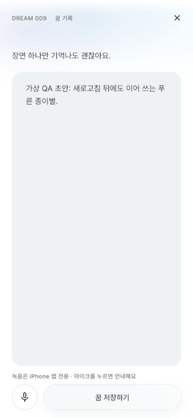

# 입력 불능 신고 후 QA / 2026-10-25

## 확인한 원인과 검증 누락

사용자가 제공한 5.75초 영상에서 Safari 웹 기록 화면의 커서가 생기고 키보드가 올라왔다가 사라진다. 영상의 실제 기록/프레임은 이 저장소에 복사하지 않았다.

Capture의 웹 전용 도움말 행과 상단 prompt가 키보드 inset에 따라 제거된다. 키 없는 Expanded/EditableText가 재생성되면서 활성 입력 연결이 끊긴다. 기존 VM 테스트는 `kIsWeb=false`였고, 키보드가 **열린 뒤**의 배치/오버플로만 검사해 실제 포커스 전환을 놓쳤다. 공개 브라우저 검사는 소개→설치 안내에 머물렀다. 이전 테스트 수와 빌드/HTTP 성공은 이 사용성의 증거가 아니었다.

새 Chrome 회귀의 390×844/375×667 두 경우가 수정 전 실패했고, 입력 slot/행동/safe content 키와 고정 FocusNode 수정 후 같은 두 경우가 통과했다. 최종 회귀는 세 화면 크기/큰 글자/밤 모드 및 저장소 실패·timeout까지5개다.

## 바꾼 것

- 입력창/입력 연결을 키보드 전환 동안 보존한다. 한글 composing/selection/내용을 임의 초기화하지 않는다. 다중 행 키보드, 줄바꿈 action을 명시했다.
- 입력창을 RepaintBoundary로 분리하고 초안 준비 전후의 추가 fade/slide를 제거한다. 입력/STT Orb·beam·RMS를 복원하지 않는다.
- 자동 저장은 onChanged 한 경로에만 의존하지 않고 controller의 실제 텍스트 변경을 감지한다. selection/composing 범위만 바뀌면 쓰지 않는다. 수동 편집 포커스가 오면 녹음을 중단해 늦은 부분 전사가 직접 수정한 내용을 덮지 않게 한다.
- 초안 읽기 실패/8초 timeout을 숨은 AbsorbPointer+무한 자동 재시도로 방치하지 않는다. 현재 기록을 지우지 않고 복구 안내/명시적 재시도를 제공한다. 늦은 읽기 응답은 새 입력을 덮지 않는다.
- 녹음 세션 토큰으로 중단한 시작 요청의 늦은 실패/전사 이벤트가 다음 세션에 영향을 주지 않게 한다. 실제 네이티브 STT나 웹 STT의 새 성공을 주장하는 변경은 아니다.
- 숨은 Home 탭/덮인 화면의 표지 모션을 실제 가시성에 연결해 정지한다. 팔레트/큰 홈/유리 버튼은 유지한다. 물리 터치 지연/FPS 개선량은 측정하지 않았다.
- 배포 스크립트가 Chrome 입력 회귀를 반드시 실행한다. [QA 기준](../../QA_RELEASE_GATE.md)과 AGENTS에 사용자 요청을 영속 기록했다.

## 실제 실행한 검증

- `dart format --output=none --set-exit-if-changed lib test integration_test tool/drift_worker.dart`: 최종133파일 변경 없음.
- 직접 `dart analyze lib test integration_test`: No issues found. `flutter analyze --no-pub`: 기존 한국어 경로 분석 서버 LSP JSON crash,exit255. 통과로 세지 않는다.
- 최종 전체 Flutter VM: **308개 통과**. Chrome 입력: **5개**, 실제 WASM/IndexedDB commit 지속성: **1개 통과**. 아래 저장 결함 수정과 controller/직접 편집 보호를 모두 포함하며 배포 스크립트도 browser6건을 다시 실행한다.
- iPhone17 Pro/iOS26.5 simulator: 실제 파일 SQLite 재열기/초안 복원1건, 음성 불가 주입→텍스트/저장 접근1건, mock 엔진의 기록→리빌 정상/재시도/폴백/실패4건, 총6건 통과. `flutter build ios --simulator --no-codesign --no-pub` 통과. 음성 검사는 실제 마이크나 Apple 서버 인식이 아니다. 기존 통합 테스트도 저장소 준비 완료를 기다리고 입력하도록 보강했다.
- 전체 검사 첫 실행은304통과/2실패였다. 음성 경합 검사는 실제 이전 구독 취소 완료를 기다린 뒤 두 번째 시작을 확인하도록 고쳤다. 기존 Outbox 테스트의 시계가10/23으로 고정돼 현재 생성 요청보다 과거라 retry가 실행되지 않았다. 테스트 시계를 현재+1시간으로 바꿨고 production Outbox 정책은 바꾸지 않았다. 이후306개, 추가 편집/자동저장 검사까지 최종308개 통과.
- Q 동결4파일은 `edfc13c`와 diff없음. 서버/SQL/LLM/원고 변경 없음.

## 이번에 완료라고 표시하지 않는 것

물리 iPhone Safari/PWA 키보드 유지·한국어 IME/음성10회·권한/5분·실제 프레임/터치 지연, Apple 실계정/서명 IPA/TestFlight 설치, 실제 hosted 입력→소설 품질은 미검증이다. 웹 마이크는 iPhone 앱 전용 안내이며 녹음기가 아니다. 10/25에도 서명 identity0개/개발팀 미설정이다. 실제 사용 가능/QA 전체 완료라고 보고하지 않는다.

최종 simulator6건과 iOS simulator 빌드, local/release web 빌드까지 순차 재실행해 통과했다. 표준 Flutter analyzer는 최종 재실행에서도 같은LSP JSON crash(exit255)이며 직접 분석은 통과했다. 공개 수정 배포는 아래 식별자로 완료했다. 전체 제품/물리기기 검증 완료를 뜻하지 않는다.

## 배포를 멈추게 한 실제 웹 저장 결함

단위 검사 뒤 실제 release/Drift 화면을 조작했다. 처음에는 저장 완료→보관함8개까지 확인됐지만 새로고침 뒤7개로 되돌아갔다. in-app 브라우저만의 격리 현상이 아니었다. 독립 Chrome에서도 같은 유실을 재현했다. 같은2.35.0 의존성으로 Worker만 다시 컴파일하는 실험도 해결하지 못했다.

설치된2.35.0 소스에서 COMMIT 당시 `isInTransaction=true`라 IndexedDB flush를 건너뛰는 것을 확인했다. [공식 #3864](https://github.com/simolus3/drift/issues/3864) 및 [2.35.2 변경 기록](https://pub.dev/packages/drift/versions/2.35.2/changelog)의2.35.1 transaction/RETURNING 지속성 수정,2.35.2 OPFS 중첩 트랜잭션 수정을 대조했다. runtime Drift만2.35.2로 고정했고 다른 패키지 버전은 올리지 않았다. 동일 lockfile로 Worker를 다시 컴파일해 클라이언트와 함께 배포하도록 했다. dev의 sqlite3 직접 선언은 이미 사용하던3.5.2를 실제 브라우저 검사에서 가져오기 위한 것이며 버전 변경이 아니다.

수정 후 같은 Chrome에서 기록8개→새로고침→8개/같은 합성 문장 유지가 확인됐다. `test/browser/web_durability_chrome.dart`는 graceful close 전에 별도의 VFS/SQLite reader를 열어 실제 IndexedDB에 row가 있는지 검사한다. fake MemoryRepository/네이티브 SQLite로 이 결함을 대체 검증하지 않는다. `test_web_durability.sh`는 public WASM 파일 하나만 localhost에 제공하고 고유 QA DB만 생성/삭제한다. 배포 스크립트가 이 검사와 입력5건을 다시 실행한다.

최종 local release(main.dart,dev/local-auth)의 실제 Drift 경로에서 자동 저장→닫기→새로고침→기록 진입→이어서 쓰기를 조작하고, 같은 합성 초안이 보이는 화면을 저장했다. root storage를 비우지 않았다.390×844, 앱 origin의 warn/error0(Chrome 확장 프로그램 경고는 별도)다. 이 흐름은 hosted 인증/동의/AI 검증이 아니다. 생산 웹은 여전히 서명 동의 전 상태까지만 열었다. [최종 초안 복원 증거](local-draft-restored.png).

DB 이름·스키마5·계정/원문/원고를 초기화하지 않았다. 과거에 디스크로 기록되지 않은 행을 복구했다고 주장하지 않는다. 기존 웹/PWA가 이전 SharedWorker를 계속 실행할 수 있으므로 업데이트 확인 시 **작성 중인 글부터 복사**한 뒤 기존 앱/탭을 완전히 종료하고 다시 열되 브라우저 데이터는 지우지 않는다. 물리 Safari/PWA의 이 전환은 미검증이다.

## 실제 공개 수정 배포

- URL: [공개 웹 체험](https://mumumong-live-trial.vercel.app/)
- Target/status: production / READY, team `mlender-ais-projects`,project `prj_VtS5dNxLxW12SsJMykVDhnXPtiUe`.
- Deployment: `dpl_8t5MxfyL6yCMYMzPZWUBmncNFhXt`,build `20261025T052146Z`.
- Framework: Flutter `lib/main.dart`,ENV=staging/ENGINE=remote/AUTH=apple. 가상 walkthrough를 공개한 것이 아니다. 웹 익명 체험/기존 서버 연결은 유지한다.
- Source SHA256: `46a8579862f269cbebb5d9e42dcae1d6f1ac3fa5597070ef6bfd32206bc9c961`. Git HEAD `6c4e296f9b3d5f06d6a50e9c1aac74b7d9f1d234`의 **dirty working tree**에서 빌드했으며 이 commit만의 소스가 아니다. 별도 commit/push 없음.
- Client Drift2.35.2,Worker SHA256 `af7417de6a9acf7417dac63d1ba166d0512fbe9c63080544f94c56afa83d1c76`.
- Production-stage의18리소스 해시를 확인한 뒤 **같은 배포**를 promote했다. 공개 alias도18개 비로그인HTTP200/로컬 hash 일치,release.json/build/source 일치. 생성 URL/preview 보호는 유지했다.
- Flutter release28.8초, Vercel Build187ms/배포 완료는 실제 로그 기준이다.
- 공개390×844 소개 재진입/렌더링,앱 origin warn/error0. [공개 실행 화면](public-release-entry.png). 동의 제출 승인이 없어 production 계정 생성/꿈 저장/AI 접수는 실행하지 않았다. 해당 E2E와 물리기기 검증은 미검증이다.
- 배포 직후 Vercel 최근10분 error-only bounded query는0개 JSON 로그다. 처음 implicit follow 호출은 실패했고 `--no-follow --no-branch`로 수정해 조회했다. static frontend라 **이것을 클라이언트/Supabase/전체 서비스 무오류로 해석하지 않는다**. 장기 모니터링/외부 telemetry는 새로 설정하지 않았다.
- 되돌릴 이전 배포 식별자: `dpl_DwdEhmErQhbcKAPrmPwjPxD4qSmj`(이전 입력/지속성 결함이 있어 무조건 안전한 버전은 아니다).

## 최종 로컬 초안 복원 화면

새로 지어낸 QA 문장, 실제 local Drift,390×844 Chrome. 새로고침 뒤 복원된 상태이며 물리 iPhone/hosted 로그인/AI 결과 화면이 아니다.

